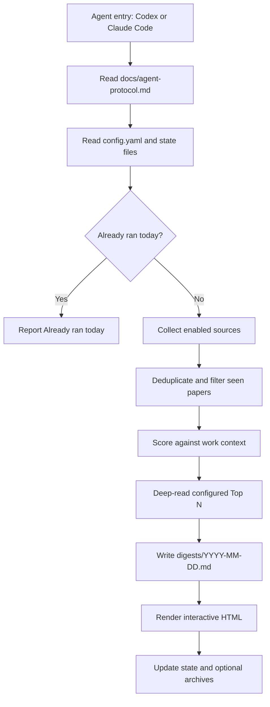

# PaperPulse

PaperPulse is an agent-ready daily paper digest system that tracks new research, filters it by your work context, and archives concise summaries for long-term knowledge building.

## What It Does

PaperPulse gives your coding or research agent a stable workflow for daily paper monitoring:

- Collect new papers from enabled sources.
- Deduplicate papers already seen in previous runs.
- Score papers against your configured work context.
- Generate a Chinese structured Markdown source and an interactive HTML report.
- Deep-read the highest-ranked papers and label the evidence depth honestly.
- Optionally sync selected papers to Notion or Obsidian when configured.

It is intentionally agent-first: the repository stores prompts, configuration, state, and output conventions, while Codex or Claude Code performs the actual collection and summarization.

## Repository Structure

```text
paperpulse/
  AGENTS.md
  README.md
  config.example.yaml
  last_run.example.json
  seen_papers.example.json
  sources-reference.md
  docs/
    agent-protocol.md
    html-report-design.md
    public-release-checklist.md
    wechat-agent-reach-notes.md
    wechat-integration.md
  codex/
    paper-digest-automation.md
    agent-copy-prompt.md
  .claude/
    commands/
      paper-digest.md
  digests/
    .gitkeep
  logs/
    .gitkeep
  scripts/
    render_digest.py
```

## Quick Start

1. Copy `config.example.yaml` to `config.yaml`.
2. Copy `last_run.example.json` to `last_run.json`.
3. Copy `seen_papers.example.json` to `seen_papers.json`.
4. Edit `filter.my_work_context`, `filter.categories`, and archive settings.
5. Choose your agent entry:
   - Codex: open the project with Codex, or send the prompt from `codex/agent-copy-prompt.md`.
   - Claude Code: run `/paper-digest` if `.claude/commands/paper-digest.md` is available in your project.



## Public-Safe Defaults

This public version does not include:

- Personal filesystem paths.
- Private Notion database IDs.
- Private Obsidian vault paths.
- Company-specific work context.
- Personal runtime state.
- Historical run digests.
- API keys, tokens, cookies, or MCP credentials.

The private runtime files `config.yaml`, `last_run.json`, `seen_papers.json`, generated digests, and logs are ignored by Git. The `*.example.*` files are the versioned initialization templates.

If you enable Notion, use your own database and agent credentials. If you enable Obsidian, use your own vault path. Do not commit private database IDs or private vault paths to a public repository.

WeChat public account collection is supported as an optional connector. See `docs/wechat-integration.md`; keep it disabled unless the local agent environment has the required third-party bridge configured.

## Output

Each successful run writes a version-neutral Markdown source and, when enabled, an interactive HTML report:

```text
digests/YYYY-MM-DD.md
digests/YYYY-MM-DD.html
```

The HTML report adds executive signals, responsive navigation, search, theme switching, a static pulse identity, and expandable evidence cards. Cards can show an official paper figure plus verified PDF, project, and code actions when those resources are recorded in Markdown; missing media falls back cleanly to the text layout. The highest-ranked papers receive full-text review according to `report.deep_read_top_n`; every card states its actual reading depth. Obsidian sync, when enabled, continues to copy the Markdown source into the configured vault directory.
