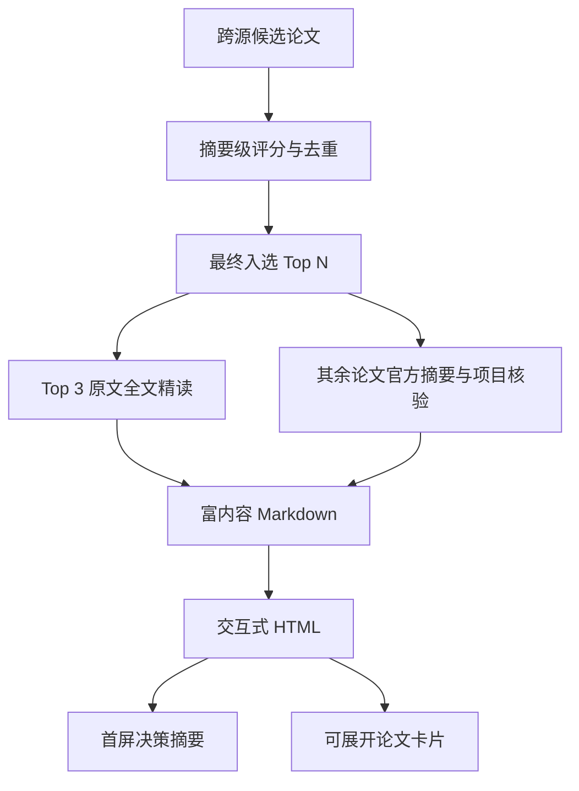

# PaperPulse 富内容 HTML 日报设计

## 背景

原有 Markdown 日报适合存档和编辑，但长内容只能线性滚动，无法同时满足快速决策与论文精读。HTML 报告应成为主要阅读界面，Markdown 继续作为稳定、可迁移的数据源。

## 问题

单纯把 Markdown 换成 HTML 不会提升研究价值。真正的瓶颈是信息没有分层、阅读深度未标注、实验依据与行动建议混在连续正文中，用户难以在一分钟内判断“今天该看什么、该做什么”。

## 方案

采用“决策层 + 证据层”的双层报告，并实行 Top 3 全文精读、其余论文摘要核验的分层策略。

### 首屏决策层

- 日期、候选数、入选数、全文精读数和最高评分。
- 背景、问题、共同技术方向和 Go/Watch/No-Go。
- 三条今日决策和可执行实验，优先说明预期指标、投入与风险。
- 数据源健康状态，避免把抓取失败误认为“当天没有论文”。
- 证据与生成说明，披露 AI 辅助流程、全文可访问性和未核验项。

### 可展开证据层

卡片收起时显示排名、标题、评分、分类、阅读深度和一句话结论。展开后按固定结构显示：

1. 为什么重要。
2. 研究问题与现有瓶颈。
3. 方法拆解。
4. 实验与精确指标。
5. 局限与失败模式。
6. 代码、模型、数据和算力等复现条件。
7. 与当前工作的模块级映射。
8. 下一步行动及验收指标。
9. 原始论文、代码和项目证据来源。

卡片允许附带一张来自论文 HTML、论文 PDF 资源或作者项目主页的代表性主图。主图在桌面端作为紧凑视觉摘要，在窄屏移到标题下方；加载失败时自动移除并恢复纯文字栅格。论文、PDF、项目主页、代码和主图使用独立操作入口，缺失资源不显示空按钮。

每条精确实验数字都必须在卡片内关联原论文表格、章节或官方项目来源。卡片同时标注证据等级：同行评审、预印本或二手发现信号。

### 交互与视觉

- 桌面端提供固定导航，移动端自动收敛为单列布局。
- 支持搜索、全部展开/收起、浅色/深色主题和阅读进度。
- 默认只展开第一篇，降低首屏认知负担。
- HTML 内嵌样式和交互脚本，不依赖前端构建工具；Mermaid 在线时增强渲染，离线时保留源文本。

视觉语言采用 Apple News 与 macOS 系统界面的共同原则，而不是复制产品营销页：

- 使用系统字体栈，标题偏向 SF Pro Display 的紧凑字距，正文保持适合中文长文的行高。
- 页面底色为 `#f5f5f7`，主强调色统一为系统蓝 `#0071e3`，取消多套竞争色。
- 卡片依靠留白、细边框和轻量弥散阴影建立层级，不使用厚重投影。
- 顶部栏、侧栏和 Hero 使用高饱和度模糊玻璃层，并通过环境色、镜面高光、半透明描边和双层阴影建立可感知的折射层次；正文卡片保持更稳定的实色阅读面。
- 正文限制在约 76 个英文字符宽度，避免大屏下单行过长。
- 自动跟随系统深浅外观，同时允许用户手动覆盖；深色模式使用纯黑背景和 `#2997ff` 强调色。
- 不使用 Apple 标志或复制具体产品组件，PaperPulse 保留独立的圆形脉冲标识。

参考 [Emil Kowalski 的 apple-design skill](https://github.com/emilkowalski/skills/blob/main/skills/apple-design/SKILL.md) 后，信息架构遵循“常用路径先出现，高级上下文放下一层”：

- 主栏在论文列表前只保留一张“今日结论 / 今日决策 / 行动建议”卡片。
- 背景、问题、方案、效果和数据源状态在侧栏显示一句话预览，完整内容放到论文列表后的折叠附录。
- 数据源健康度使用“正常 / 部分 / 失败 / 停用 / 未运行”五态展示；停用与未运行不进入失败统计，避免把配置决策误报为系统故障。
- 删除与论文卡片重复的 Top N 汇总表，避免同一信息出现两次。
- 主玻璃材质只用于 Hero、浮动工具栏和侧栏；指标、正文和论文卡片使用稳定实色阅读面，避免半透明表面层层叠加。
- 页面底层加入克制的蓝、青、紫环境光，让 `backdrop-filter` 的透光和模糊能够被肉眼感知，而不是只写了透明度却看不到材质差异。
- 左上品牌标识使用静态脉冲波形与细圆环，不使用循环动画，避免持续运动分散论文阅读注意力。
- 有官方主图的论文卡片采用图文栅格，没有主图时自动回退到原有文字栅格，保证不同来源下仍保持一致密度。
- 为 `prefers-reduced-transparency` 和 `prefers-contrast` 提供独立降级样式，而不仅处理 reduced motion。

## 效果

| 指标 | 当前 | 目标 |
|---|---:|---:|
| 全文精读论文 | 未显式要求 | 每日 Top 3 |
| 单篇精读内容 | 约 150-300 字 | 600-1000 字 |
| 阅读深度标识 | 无 | 100% 卡片标注 |
| 实验数字溯源 | 不固定 | 100% 关联原始证据 |
| 查看详细内容 | 连续滚动 | 按需展开 |
| 论文列表前的大段内容 | 7 个独立区块 | 1 个决策卡片 |
| 论文视觉证据 | 无 | 有官方资源时显示 1 张主图 |
| 资源入口 | 仅论文原文 | 论文 / PDF / 项目 / 代码 / 主图 |
| 输出格式 | Markdown | Markdown + HTML |
| 代码依赖 | 无 | 仍为 Python 标准库 |

**Go**：采用该结构作为后续每日任务默认输出。若连续一周运行时间不可接受，再将全文精读数量从 3 调整为 2，而不降低证据标注标准。
